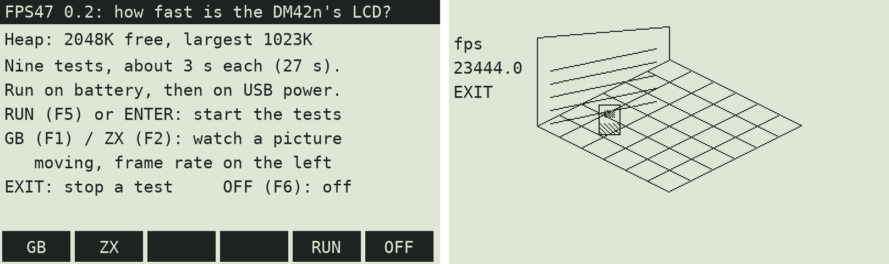

# GB47 — towards a Game Boy emulator for the DM42n

**GB47** is the plan for a Game Boy emulator as a native DMCP5 program (`.pg5`) for the SwissMicros **DM42n**,
built like [Chess 47](https://github.com/valdesvj/chess47.pg5), [NAV47](https://github.com/valdesvj/nav47.pg5) and
[TERM47](https://github.com/valdesvj/term47.pg5).

The DM42n (STM32U575, Cortex-M33 at 80/160 MHz, 786 KB RAM) has plenty of power for a Game Boy (8 KB RAM, 160×144
pixels): small Game Boy emulators in C already run at full speed on smaller chips. The open question is the screen:
**how many whole frames a second the 400×240 LCD can show.** The first tool here measures that.

## Tool: FPS47, the LCD frame-rate test



`release/FPS47.pg5` measures the heap a program gets, then runs nine tests of about 3 seconds each, and shows the
results on the screen:

| Test | What it does |
|---|---|
| FULL forced | all 240 lines change every frame, `lcd_forced_refresh` |
| FULL fill | the whole screen black / white with `lcd_fill_rect`, `lcd_refresh` (DMCP's own way) |
| **GB lines** | a Game Boy frame (160×144 drawn 1.5× = 240×216, 4 greys as dot patterns) written straight into the LCD buffer, `lcd_refresh_lines` on its 216 lines — **the emulator's way** |
| GB forced | the same frame, all 240 lines sent |
| GB rects | the same frame drawn with `lcd_fill_rect` (as NAV47 and TERM47 draw) |
| GB draw only | the drawing alone, no refresh: the CPU's part |
| lines only | sending 216 unchanged lines: the LCD's part |
| ZX full | a ZX Spectrum frame (256×192, 1 bit, 1:1) written straight in, all its 192 lines sent |
| **ZX part** | the same frame, only the band of lines that changed sent: a sprite moving in a still room, as Knight Lore or Head over Heels draw — **the Spectrum emulator's way** (for [ZX47](https://github.com/valdesvj/zx47.pg5)) |
| heap (at start) | the largest block `malloc` gives, and the total free (shown on the start page and in the results) |

For each test: **fps** (frames a second), **draw** (ms of drawing a frame) and **lcd** (ms the LCD takes a frame).
Every frame waits for the LCD to finish, so the fps is what you see.

**GB (F1)** and **ZX (F2)** run the Game Boy picture or the Spectrum room without end, with the frame rate on the
left: look whether the moving ball or sprite smears or flickers.

### How to run it

1. Copy `release/FPS47.pg5` to the calculator's disk (keep `DM42-x.yy.pg5` there too, to go back).
2. **SETUP → System → Run DMCP** (or RESET with F1 held), **Load program → FPS47.pg5**.
3. **On battery** (USB cable out): press **RUN** (F5). Wait about 27 s.
4. **On USB power** (cable in): press **RUN** again.
5. The results are saved as `/FPS47/RESULT_BAT.TXT` and `/FPS47/RESULT_USB.TXT`. Connect the USB disk and send
   them, or a photo of the screen.

**EXIT** stops a test. **OFF** (F6) turns the calculator off; load your usual program from the DMCP menu.

FPS47 loads on DMCP5 3.57 or later (interface 3.17): no firmware update needed. (Version 0.2 as first published
asked for 3.58 and showed "> 3.18" on older firmware: take this one.)

### What the numbers decide

| GB lines, fps | For a Game Boy emulator |
|---|---|
| 30 or more | smooth: draw every 2nd Game Boy frame (the Game Boy makes 60) |
| 15–30 | playable: draw every 3rd or 4th frame, the game itself still runs at full speed |
| under 15 | slow-moving games only (puzzles, RPGs), or a smaller picture |

| ZX part, fps | For a ZX Spectrum emulator |
|---|---|
| 25 or more | as the real Spectrum: Knight Lore, Head over Heels, Gunfright run at their own speed |
| 12–25 | close to the original: those games draw only 10–15 frames a second themselves |
| under 12 | slower than the original in busy rooms |

The heap decides the machines: a 48K Spectrum needs 64 KB, a 128K Spectrum 128 KB + 32 KB, a Game Boy 16 KB + the
cartridge (32 KB to 1 MB: large cartridges are read from the disk in pieces).

## Build

Requirements: `arm-none-eabi-gcc` with newlib, `make`, `python3` (Pillow for the simulator pictures).

```bash
cd ~/opt/gb47.pg5
make fps          # -> build/fps/FPS47.pg5
make fps-shots    # the PC simulator's screens -> build/fps/run/*.png
```

The simulator runs the real `fps47.c` against a fake DMCP layer, to check the screens and the results file. Its
timings mean nothing (its LCD costs no time): only the calculator gives the real numbers.

## Files

| | |
|---|---|
| `tools/fps47/` | FPS47: `fps47.c`, its `main.h` (program name, version) |
| `dmcp/`, `stm32_program.ld` | the SwissMicros DMCP5 SDK (BSD-3) |
| `src/sercon_ifc.h` | DMCP5 3.58's serial console (for the emulator later, as TERM47) |
| `tools/pg5tool.py` | makes the `.pg5` (from Chess 47) |
| `test/sim/` | the PC simulator (from TERM47 and Chess 47) |

## License

GPL-3.0-or-later (see `LICENSE` and `NOTICE`). The DMCP5 SDK files are BSD-3 (`LICENSE.DMCP5_SDK`).

This project was written with the help of AI; see [AI_ASSISTANCE.md](AI_ASSISTANCE.md).

SwissMicros and DM42 are trademarks of their owners. Game Boy is a trademark of Nintendo. This project is not
affiliated with or endorsed by them, and comes with no games: use homebrew games or your own dumps.
